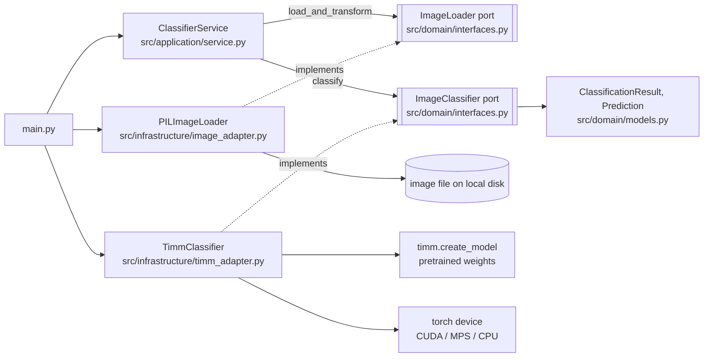

# Computer-Vision: documentation hub

Computer-Vision is a Python command-line program and library. It classifies one
image file with a pretrained model from the `timm` library and prints the top
predicted class and its confidence (`main.py`, `src/`). The code is split into
domain, application and infrastructure layers, and the ports are
`typing.Protocol` classes (`src/domain/interfaces.py`).

The project description says the goal is mushroom classification
(`pyproject.toml:4`, `README.md:1-3`). The code has no mushroom-specific model,
label set or training step. It returns whatever class the chosen pretrained
model predicts. The code does not say who the users are.
`docs/quality-iso25010.md:108-109` calls the project "a teaching repository".

## Status

| Item | Value | Source |
| --- | --- | --- |
| Last commit on `dev` | `515d10a`, 2026-08-06, "chore: release 1.0.0"; tag `v1.0.0` points to it | `git log -1`, `git tag` |
| Package version | 1.0.0 | `pyproject.toml:3` |
| Other branches | `origin/release` and `origin/test` have later commits that are not in `dev` (tag `v1.1.0` → `140378c`, 2026-11-08; `git diff --stat` shows new files such as `uv.lock` and `tools/wiki.py`). **This hub describes `dev` at `515d10a` only.** | `git log origin/release`, `git diff --stat 515d10a v1.1.0` |
| Tests | 6 test cases (5 functions) in `tests/`, and 6 benchmark cases (4 functions) in `benchmarks/` | `tests/test_classification.py`, `benchmarks/test_pipeline_performance.py` |
| CI | three GitHub Actions workflows: `python-ci.yml` (format, lint, types, tests), `release.yml` (wheel and sdist on a tag), `secret-scan.yml` (gitleaks) | `.github/workflows/` |
| TODO / FIXME | 0 in the project code (`main.py`, `src/`, `scripts/`, `tests/`, `benchmarks/`) | grep |
| Visibly unfinished | `all_predictions` holds only the top prediction (`src/infrastructure/timm_adapter.py:58-59`). `scripts/profile_application.py` stops on import with `ModuleNotFoundError: No module named 'quality_template'` (checked by running it). Several documents mention files or checks that the repository does not have (see [Known limitations](#known-limitations-and-problems)). | see the sources |

The state of CI on GitHub for `515d10a` was not checked, because no network calls were allowed.

## Layout

| Path | What it is |
| --- | --- |
| `main.py` | Command-line entry point. Builds the adapters and the service, classifies one image and prints a `rich` table |
| `src/domain/models.py` | Frozen dataclasses `Prediction` and `ClassificationResult` |
| `src/domain/interfaces.py` | Ports `ImageClassifier` and `ImageLoader` (`runtime_checkable` Protocols) |
| `src/application/service.py` | `ClassifierService`: loads the image through the loader, then classifies it through the classifier |
| `src/infrastructure/timm_adapter.py` | `TimmClassifier`: creates the timm model, picks the device, uses FP16 on GPU, applies softmax and returns the top-1 class |
| `src/infrastructure/image_adapter.py` | `PILImageLoader`: opens the file, resizes, centre-crops, normalises, adds the batch dimension |
| `tests/conftest.py`, `tests/test_classification.py` | Unit tests with mocked timm models and mocked ports |
| `benchmarks/test_pipeline_performance.py` | `pytest-benchmark` measurements of preprocessing and of the service with a stub model |
| `scripts/build_release_artifact.py` | Builds the wheel and sdist into `release/`, runs an import check on the wheel (passes from the checkout root regardless, see [Known limitations](#known-limitations-and-problems)), writes `.sha256` files |
| `scripts/check_before_push.py` | Runs the ruff/mypy/pytest commands found in `.github/workflows/` on the local machine. Can install a `pre-push` hook |
| `scripts/collect_quality_metrics.py` | Computes four ISO/IEC 25010 scores (tests, coverage, radon complexity, CI portability) |
| `scripts/enforce_branch_policy.py` | Reports branches other than `release`, `dev`, `test`. Can delete them, but only if they are already merged |
| `scripts/install_dependencies.py` | `pip install -e .` / `.[dev]`; `--lock` / `--from-lock` work with `requirements-dev.lock` |
| `scripts/profile_application.py` | cProfile wrapper around `quality_template.core`, a module that does not exist in this repository (broken) |
| `docs/architecture.md`, `docs/branching.md`, `docs/quality-iso25010.md` | Documents written by the author (not changed here) |
| `docs/index.html`, `docs/src.html`, `docs/src/`, `docs/search.js` | API reference HTML generated by pdoc 16.0.0 (`docs/src.html`) |
| `docs/images/classification-run.png` | Screenshot of a classification run, shown in the README |
| `.agent/` | Third-party AI-agent kit (rules, skills, workflows, scripts). Ruff excludes it (`pyproject.toml:25-26`). `.agent/ARCHITECTURE.md:1` names it "AntigravityCppKit". The project uses `.agent/scripts/check_commit_msg.py` (commit-msg hook) and `.agent/scripts/docs_python.py` (API docs) |
| `.github/workflows/` | CI, release and secret-scan workflows |
| `.pre-commit-config.yaml` | ruff, ruff-format, generic hooks, local commit-message check |
| `pyproject.toml` | Package metadata, dependencies, ruff and mypy settings |
| `CHANGELOG.md`, `CONTRIBUTING.md`, `SECURITY.md`, `LICENSE` | Changelog, contributor rules, security policy, MIT licence |

## Architecture

There are three layers. `main.py` wires them together:

- **Domain** (`src/domain/`): the result types and the two ports. `interfaces.py`
  imports `torch` (`src/domain/interfaces.py:4`), because the ports take and
  return `torch.Tensor`.
- **Application** (`src/application/service.py`): `ClassifierService` passes
  the path to the loader and the loader's tensor to the classifier. It returns
  the classifier's result unchanged (`service.py:24-25`).
- **Infrastructure** (`src/infrastructure/`): `TimmClassifier` and
  `PILImageLoader` implement the ports.

Data flow for one call to `python main.py <image>`:

1. `TimmClassifier(model_name="vit_base_patch16_384")` calls
   `timm.create_model(name, pretrained=True)`. It picks CUDA, then MPS, then
   CPU, switches the model to eval mode, and converts the model to FP16 when
   the device is not CPU (`timm_adapter.py:17-31`).
2. `get_input_size()` reads `default_cfg["input_size"][-1]`, or 224 if the key
   is missing. `PILImageLoader(size)` is built with that size
   (`main.py:27-30`, `timm_adapter.py:70-75`).
3. `ClassifierService.classify_image(path)` → `load_and_transform` → a tensor
   of shape `[1, 3, size, size]` → `classify` → `ClassificationResult`
   (`service.py:14-25`, `image_adapter.py:24-32`).
4. `main.py` prints a table with the model, the top label and the confidence
   (`main.py:40-48`).



External systems and hardware:

- **Pretrained weights.** `timm.create_model(pretrained=True)` downloads
  weights (`benchmarks/test_pipeline_performance.py:9-10`,
  `docs/quality-iso25010.md:138-139`). The repository does not set the source
  or the cache location.
- **GPU.** CUDA or Apple MPS through `torch`, if available. Otherwise CPU
  (`timm_adapter.py:18-23`).
- **GitHub.** Actions, Releases and gitleaks, used only by the workflows.

The author's own architecture notes are in [architecture.md](architecture.md).

## Build and run

Prerequisites:

| What | Version | Source |
| --- | --- | --- |
| Python | `>=3.10` (CI uses 3.10) | `pyproject.toml:6`, `.github/workflows/python-ci.yml:18` |
| `torch`, `torchvision`, `timm` | not pinned | `pyproject.toml:7-11` |
| Dev tools: `pytest`, `pytest-cov`, `pytest-mock`, `ruff`, `mypy`, `pytest-benchmark` | not pinned | `pyproject.toml:14-21` |
| `rich` | **not declared**, but imported by `main.py:3-5` | `main.py` |
| Network access | needed the first time a model is created (weight download) | `benchmarks/test_pipeline_performance.py:9-10` |
| GPU | optional (CUDA or MPS) | `src/infrastructure/timm_adapter.py:18-23` |

Install (choose one):

```bash
python -m venv venv
source venv/bin/activate        # or venv\Scripts\activate on Windows
pip install -e ".[dev]"
```
Source: `README.md:66-70`.

```bash
python scripts/install_dependencies.py --dev
```
Source: `scripts/install_dependencies.py:4`, `CONTRIBUTING.md:8`. This runs
`pip install --upgrade pip` and then `pip install -e .[dev]`
(`scripts/install_dependencies.py:107-108`). `--from-lock` needs
`requirements-dev.lock`, which is not in the repository, so it exits with an
error (`scripts/install_dependencies.py:96-102`).

```bash
uv sync --all-extras
```
Source: `.github/workflows/python-ci.yml:24` (this is how CI installs).

Run:

```bash
python main.py data/data/agaric/example.jpg
```
Source: `README.md:76`. The example path is not in the repository: `data/` is
gitignored (`.gitignore:2`). Pass the path of any local image.

Build the API reference HTML into `docs/`:

```bash
python .agent/scripts/docs_python.py
```
Source: `README.md:87`. It runs `python -m pdoc src -o docs`
(`.agent/scripts/docs_python.py:24`). `pdoc` is not a declared dependency.

Build the release artefacts:

```bash
python scripts/build_release_artifact.py --version v1.0.0
```
Source: `scripts/build_release_artifact.py:3`. It needs the `build` module
(`scripts/build_release_artifact.py:40-49`). The release workflow installs it
with `python -m pip install --upgrade pip build` (`.github/workflows/release.yml:31`).

## Configuration

The project code reads no environment variables (grep for `environ` / `getenv`
over `main.py`, `src/`, `scripts/`, `tests/`, `benchmarks/` found nothing). The
only secret is `GITHUB_TOKEN`, which the gitleaks step in CI uses
(`.github/workflows/secret-scan.yml:26`).

Command line of `main.py`:

| Argument | Meaning | Default | Source |
| --- | --- | --- | --- |
| first positional argument | path of the image file | `image.png` | `main.py:61` |
| model | `vit_base_patch16_384`, not settable from the command line | — | `main.py:17`, `main.py:62` |

Constructor parameters (library use):

| Parameter | Meaning | Default | Source |
| --- | --- | --- | --- |
| `TimmClassifier(model_name)` | any name accepted by `timm.create_model` | required | `timm_adapter.py:13-16` |
| `TimmClassifier(pretrained)` | load pretrained weights | `True` | `timm_adapter.py:14` |
| `TimmClassifier(use_fp16)` | half precision; ignored on CPU | `True` | `timm_adapter.py:14`, `:29` |
| `PILImageLoader(size)` | resize and centre-crop size in pixels | `224` | `image_adapter.py:14` |
| `main(image_path, model_name)` | the same values as the CLI, as function arguments | `"image.png"`, `"vit_base_patch16_384"` | `main.py:16-18` |

Config files:

| File | What it sets |
| --- | --- |
| `pyproject.toml` | ruff: line length 88, target py310, rules `E F B I UP`, `.agent` excluded (`:24-32`). mypy: `strict = true`, Python 3.10 (`:34-42`). setuptools build backend (`:44-46`) |
| `.pre-commit-config.yaml` | ruff `v0.4.1` with `--fix`, ruff-format, pre-commit-hooks `v4.6.0` (trailing-whitespace, end-of-file-fixer, check-yaml, check-added-large-files), and a local `commit-msg` hook `.agent/scripts/check_commit_msg.py` |

The flags of the helper scripts are listed in [SPEC.md, section 4.2](../SPEC.md#42-helper-scripts).

## Usage

**Classify one image.**

```bash
python main.py path/to/photo.jpg
```

The output has the lines "Initializing model", "Detected input size" and
"Processing image", followed by a table with `Model`, `Top Prediction` and
`Confidence` (4 decimals) (`main.py:23-48`). When the model's `default_cfg`
has no `label_names`, the label is `class_<index>` (`timm_adapter.py:50-54`).
`README.md:7-9` shows the run in the screenshot: class 992 for an ImageNet
photo. A missing file prints `Error: Image not found at <path>` and exits with
code 1 (`image_adapter.py:26-27`, `main.py:50-52`).

**Use as a library with another timm model.** These are the steps that
`main.py:24-37` runs:

```python
from src.application.service import ClassifierService
from src.infrastructure.image_adapter import PILImageLoader
from src.infrastructure.timm_adapter import TimmClassifier

classifier = TimmClassifier(model_name="vit_base_patch16_384")
loader = PILImageLoader(size=classifier.get_input_size())
result = ClassifierService(classifier=classifier, loader=loader).classify_image("photo.jpg")
print(result.top_prediction.label, result.top_prediction.confidence)
```

**Measure preprocessing.**

```bash
pytest benchmarks --benchmark-only
pytest benchmarks --benchmark-only --benchmark-compare
```
Source: `README.md:53`, `benchmarks/test_pipeline_performance.py:12-13`.
Started like this, through the `pytest` console script, collection fails with
`No module named 'src'` (measured on a reduced copy, see
[SPEC.md, open question 5](../SPEC.md#9-open-questions)). Use
`python -m pytest benchmarks --benchmark-only`, which puts the current
directory on `sys.path`.

**Check locally what CI would check, before a push.**

```bash
python scripts/check_before_push.py
python scripts/check_before_push.py --install-hook
```
Source: `scripts/check_before_push.py:15-16`.

**Quality report.**

```bash
python scripts/collect_quality_metrics.py --output quality-report.json
```
Source: `docs/quality-iso25010.md:9`. It needs `radon`, which is not declared.
`*.json` is gitignored (`.gitignore:11`).

**Branch policy.**

```bash
python scripts/enforce_branch_policy.py --remote origin
python scripts/enforce_branch_policy.py --delete-extra
```
Source: `docs/branching.md:35-36`.

**Release.** Push a tag that matches `v*.*.*`. `release.yml` then builds the
wheel and sdist and publishes a GitHub Release, with `CHANGELOG.md` as the
body (`.github/workflows/release.yml:5-7`, `:60-66`). `docs/branching.md:63-67`
lists the git steps.

## Testing

How to run:

```bash
pytest
```
Source: `CONTRIBUTING.md:18`. CI runs `uv run pytest --cov=src --cov-report=xml`
(`.github/workflows/python-ci.yml:36`) after `ruff format --check .`,
`ruff check .` and `mypy --strict .` (`:27-33`). `pyproject.toml` has no
`[tool.pytest.ini_options]`. Inference from pytest's default discovery: a bare
`pytest` therefore collects both `tests/` and `benchmarks/`. This matches the
"12 tests" in `docs/quality-iso25010.md:16`.

What the tests cover (`tests/test_classification.py`):

| Test | Checks |
| --- | --- |
| `test_service_orchestration` | the service calls `load_and_transform` once with the path, then `classify` once, and returns that result |
| `test_image_loader_not_found` | `PILImageLoader` raises `FileNotFoundError` for a missing path |
| `test_timm_adapter_init` | `timm.create_model(name, pretrained=True)` is called and the model is put in eval mode |
| `test_timm_classifier_classify[True/False]` | top label from `label_names` (`cat`), or `class_0` when there are no labels; confidence ≈ 1.0 |
| `test_timm_classifier_get_input_size` | the input size is read from `default_cfg["input_size"]` (299) |

All classifier tests replace `timm.create_model` with a mock (`tests/conftest.py:16-33`).
No test downloads weights or classifies a real photo. `docs/quality-iso25010.md:33-35`
notes the same gap. The fixture returns itself from `.half()`, `.to()` and
`.eval()`, so the tests behave the same with and without a GPU
(`tests/conftest.py:26-32`). No test checks which device is chosen or that FP16
is used.

The benchmarks (`benchmarks/test_pipeline_performance.py`) write random JPEGs of
224, 512 and 2048 px to a temporary directory. They time `load_and_transform`
at target sizes 224 and 384, the service with a stub classifier, and the
missing-file path, and they check the output shapes. They have no pass/fail
time threshold. The medians in `README.md:32-39` are the author's measurements
and were not reproduced here.

## Known limitations and problems

Behaviour of the code:

1. `ClassificationResult.all_predictions` contains only the top prediction
   (`src/infrastructure/timm_adapter.py:58-59`).
2. `classify` applies softmax to `output[0]` only. For a batch of more than one
   image, only the first image gets a result (`timm_adapter.py:45`).
3. Normalisation is fixed at mean 0.5 and std 0.5 for each channel
   (`image_adapter.py:20`). The model's own `default_cfg` mean/std is not read.
   The code does not check whether these values match the model's training
   preprocessing.
4. `get_input_size` returns only the last element of `input_size`, which
   assumes a square input (`timm_adapter.py:74-75`).
5. The CLI cannot choose the model and has no `--help`. `python main.py --help`
   treats `--help` as an image path (`main.py:61`). The model is created before
   the image path is checked (`main.py:24` vs `main.py:37`), so a mistyped path
   still costs a model load, and a weight download on the first run.
6. The project code sets no timeout or retry for the weight download (grep for
   `timeout|retry` found nothing).
7. `rich` (`main.py:3-5`), Pillow (`src/infrastructure/image_adapter.py:5`) and
   `numpy` (`benchmarks/test_pipeline_performance.py:21`) are imported but not
   declared in `pyproject.toml`. Pillow and numpy probably come in through
   torch/torchvision. That is an inference and was not verified here.
8. No lock file is in `dev`, and the runtime and dev dependencies have no
   version bounds (`pyproject.toml:7-21`); only `pyinstaller>=6.0` has one
   (`:22`).
9. `scripts/profile_application.py:22` imports `quality_template.core`, which
   is not in the repository. Running it gives `ModuleNotFoundError`.
10. `scripts/collect_quality_metrics.py` gives numbers when the tool behind
    them is missing. Without radon the maintainability score is `0.0` and the
    average complexity is `0.0` (`:114`, `:122`, `:136-139`). Without ruff,
    `outstanding_lint_findings` is `0` (`:129-134`). It prints no warning in
    either case.
11. CI tests only ubuntu-latest with Python 3.10 on CPU
    (`.github/workflows/python-ci.yml:11`, `:18`). The CUDA, MPS and FP16 paths
    are not run automatically (`docs/quality-iso25010.md:161-167` says the same).
12. The wheel has no `src` package. Built from a temporary copy (setuptools
    84.0.0, offline), it holds top-level `domain`, `application`,
    `infrastructure` and a stray `__init__.py`; installed, `import src` fails
    outside a checkout and `import application.service` fails with
    `attempted relative import beyond top-level package`. The release script's
    `import src` check (`scripts/build_release_artifact.py:80-85`) runs in the
    caller's working directory, so from the checkout root it imports the
    checkout's `src/` and passes anyway. Details in
    [SPEC.md, open question 4](../SPEC.md#9-open-questions).

Documents and config that contradict the code (these documents were left
unchanged):

| Statement | Where | What the repository has |
| --- | --- | --- |
| profiling results in `profile_results_optimized.txt` | `README.md:24` | no such file; `profile_results*.txt` is gitignored (`.gitignore:56`) |
| `task3.py` for prototyping | `README.md:80` | no such file; `task*.py` is gitignored (`.gitignore:63`) |
| Domain has "zero dependencies on external libraries" | `README.md:15` | `src/domain/interfaces.py:4` imports `torch` |
| ports are "abstract base classes" | `docs/architecture.md:34` | they are `Protocol` classes (`src/domain/interfaces.py:9-10`, `:26-27`) |
| returns "the full ranking" | `docs/quality-iso25010.md:28` | top-1 only (`timm_adapter.py:58-59`) |
| `main.py` has `--help` | `docs/quality-iso25010.md:103` | no argument parser (`main.py:61`) |
| flake8-bandit (`S`) rules run on every push | `docs/quality-iso25010.md:134`, `SECURITY.md:17` | ruff selects `E F B I UP` only (`pyproject.toml:31`) |
| `.github/workflows/branch-policy.yml` runs the branch check | `docs/branching.md:30-32` | no such workflow |
| the release workflow "runs the tests, builds the executable and the zip" | `docs/branching.md:69-71` | `release.yml` builds a wheel and an sdist and runs no tests |
| clone URL and directory `repo-quality-template` | `CONTRIBUTING.md:6-7` | a different repository name |
| coverage `fail_under` 85 in `pyproject.toml`; ruff `C90`; gitleaks in pre-commit | `CONTRIBUTING.md:31-33` | none of the three is configured |
| commit types `perf`, `build`, `ci`, `security`; no scope required | `CONTRIBUTING.md:44-45` | the commit-msg hook accepts only `feat`, `feature`, `fix`, `bugfix`, `docs`, `refactor`, `test`, `chore`, requires `(scope)` and a final period (`.agent/scripts/check_commit_msg.py:31`) |
| logic in `core.py`, `cli.py`, `app.py`; `[Unreleased]` in the changelog | `CONTRIBUTING.md:52-58` | none of these exist |
| gitleaks job in `ci.yml`; `detect-private-key` hook; `requirements-dev.lock` | `SECURITY.md:15-18` | the job is in `secret-scan.yml`; no such hook; no lock file |
| the wheel brings a "console entry point" | `scripts/build_release_artifact.py:13-14` | `pyproject.toml` has no `[project.scripts]` |
| installing the wheel puts a top-level `src` into site-packages | `docs/quality-iso25010.md:91-97` | the built wheel has top-level `domain`, `application`, `infrastructure` instead (limitation 12) |
| `pip install -e ".[release]"` provides the build backend | `scripts/build_release_artifact.py:47-48` | the `release` extra contains only `pyinstaller>=6.0` (`pyproject.toml:22`), not `build` |
| a manual release run takes a required `version` input | `.github/workflows/release.yml:8-12` | no step reads it; the build gets `github.ref_name` (`release.yml:34`) |
| error text "'uv' command not found" | `.agent/scripts/docs_python.py:31-33` | the script runs `python -m pdoc`, not uv |

## Related documents

- [Project README](../README.md)
- [Software requirements specification](../SPEC.md)
- [Architecture](architecture.md)
- [Branching and releasing](branching.md)
- [ISO/IEC 25010 quality assessment](quality-iso25010.md)
- [API reference, pdoc HTML](index.html) (opens [src.html](src.html); GitHub shows HTML as source)
- [Changelog](../CHANGELOG.md)
- [Contributing](../CONTRIBUTING.md)
- [Security policy](../SECURITY.md)
- [Licence](../LICENSE)
- [Agent kit overview](../.agent/ARCHITECTURE.md)

## About this document

Written on 2026-11-18 from commit `515d10a` (branch `dev`), by reading the files
cited above.

Commands run (all read-only):

- `git status -sb`, `git log`, `git ls-files`, `git branch -a`, `git tag`,
  `git show --stat HEAD`, `git diff --stat 515d10a v1.1.0`.
- grep over the project code for `TODO|FIXME|XXX|HACK`, `environ|getenv`,
  `timeout|retry`, `pyinstaller|radon|pdoc`.
- `python -B scripts/<name>.py --help` for `build_release_artifact`,
  `check_before_push`, `collect_quality_metrics`, `enforce_branch_policy` and
  `install_dependencies`. They printed the flags listed in SPEC.md, section 4.2.
- `python -B scripts/profile_application.py --help` →
  `ModuleNotFoundError: No module named 'quality_template'`.
- A module check of the local interpreter (Python 3.13.3). `torch`,
  `torchvision`, `timm`, `pytest-mock`, `pytest-benchmark`, `pytest-cov`,
  `ruff`, `mypy` and `radon` are not installed.
- In temporary copies outside the repository, during the check of this
  document: `python -m build --wheel --no-isolation --skip-dependency-check`
  (setuptools 84.0.0), then `pip install --no-deps` of the wheel into a fresh
  venv and import probes; and a pytest 9.1.1 probe on a reduced copy
  (`src/domain`, a conftest and a benchmark that import `src`), with and
  without an editable install.

Not run: any install (`pip`, `uv sync`); `pytest`, including
`--collect-only` (the dependencies are missing); the benchmarks; `main.py`
(needs torch and a weight download); `ruff`; `mypy`;
`build_release_artifact.py`; `collect_quality_metrics.py`;
`check_before_push.py`; the GitHub workflows. The state of CI on GitHub was not
checked (no network).
